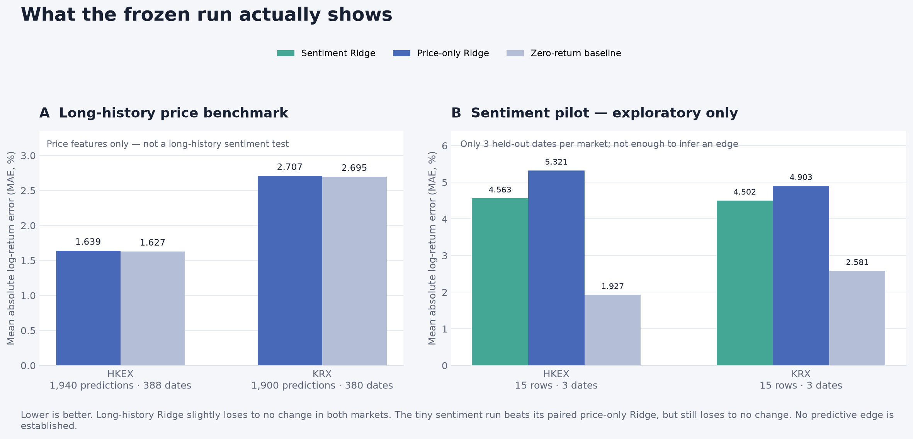
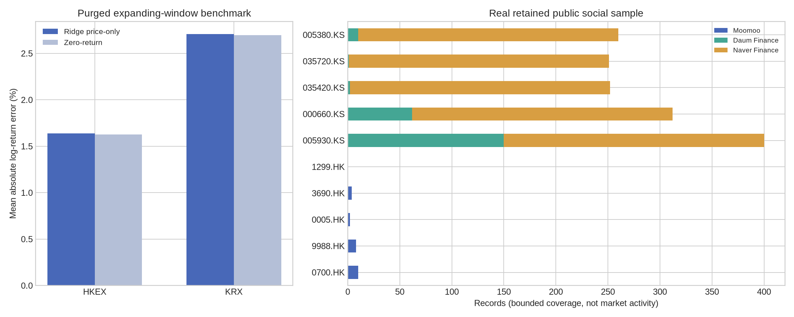
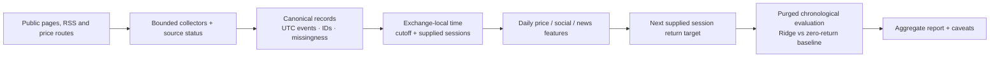
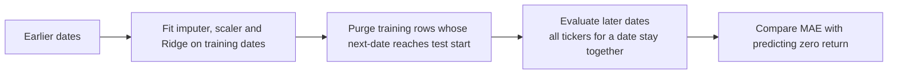

# HKEX + KRX Investor Sentiment Research Prototype

A Python research project testing whether public investor discussion adds information about the **next trading session's return** for five Hong Kong and five Korean stocks. It focuses on clear data handling, market-time alignment, leakage-aware evaluation, and honest reporting—not on claiming a profitable strategy.

> **Read this before interpreting the charts:** the frozen run cost **$0** in external data-provider spend. **No Apify Actor was run and no Exa request was made.** Public collectors and Google News RSS were documented substitutes; this is a working prototype, **not a fully assignment-compliant submission**. The simple baselines were not beaten, and no predictive edge is established.

## At a glance

| | What the project contains or found |
|---|---|
| Universe | 10 equities: five HKEX and five KRX tickers |
| Frozen data run | 1,499 retained public social records, 110 RSS headlines, 4,875 daily bars, and 10 separate quote snapshots |
| Main test | Four expanding chronological folds; Ridge regression compared with predicting a zero return |
| Main result | The long-history price-only model had slightly higher MAE than the zero-return baseline in both markets |
| Sentiment result | The exploratory sentiment test had only 15 rows across 3 test dates per market; it also lost to the zero-return baseline |
| Spend and provider status | $0 external spend; Apify and Exa were not used |

**Quick links:** [run results](RUN_RESULTS.md) · [learning and code guide](LEARNING_GUIDE.md) · [interview cheat sheet](INTERVIEW_CHEATSHEET.md) · [interactive study pack](INTERVIEW_STUDY_PACK.html) *(download and open locally; GitHub does not execute repository HTML)* · [data-source notes](DATA_ACCESS.md) · [implementation plan](IMPLEMENTATION_PLAN.md)

## What the evidence shows

The charts below are project-generated from the frozen aggregate run and retained-record counts. They contain aggregate metrics only; they do not expose individual post text or credentials.



*Lower MAE is better. Read the printed values: the two panels use different vertical scales. In the long-history price-only test, Ridge is slightly worse than “no change.” In the tiny sentiment pilot, sentiment Ridge is better than its paired price-only Ridge, but both are worse than “no change.” Three test dates are far too few to claim a sentiment edge.*



*Left: long-history price-only model errors versus the zero-return reference. Right: retained social records by ticker/source. These source counts describe this bounded collection only—not total market discussion. Zero retained records means no rows were kept, not that no discussion exists.*

### Frozen evaluation metrics

Mean absolute error (MAE) is measured on **log returns**; lower is better. The displayed percentages are log-return errors—not accuracy percentages or guaranteed price-error bands. “Zero return” predicts no price change for every test row. Directional accuracy is the share of predictions with the correct sign; it is not profitability.

| Market and test | Ridge MAE | Zero-return MAE | Test sample | Ridge directional accuracy |
|---|---:|---:|---:|---:|
| HKEX price-only, long history | 1.639% | **1.627%** | 1,940 rows · 388 dates | 47.5% |
| KRX price-only, long history | 2.707% | **2.695%** | 1,900 rows · 380 dates | 48.5% |

| Short sentiment experiment | Sentiment Ridge MAE | Paired price-only Ridge MAE | Zero-return MAE | Test sample |
|---|---:|---:|---:|---:|
| HKEX | 4.563% | 5.321% | **1.927%** | 15 rows · 3 dates |
| KRX | 4.502% | 4.903% | **2.581%** | 15 rows · 3 dates |

The long-history results are **price-only**; they are not a long-history social-sentiment backtest. The short experiment covers only seven observed feature sessions and three held-out dates per market. Its lower error than the paired price-only model is not enough evidence that sentiment adds durable predictive value. No transaction costs, slippage, liquidity, portfolio risk, or live-trading performance are established. Full metric context is in [RUN_RESULTS.md](RUN_RESULTS.md).

## Project scope and stock universe

The research question is: **when public social and headline information is available before a stated exchange-local cutoff, does it improve a simple next-session return forecast over a transparent benchmark?** The selected universe in [`config/assets.csv`](config/assets.csv) is:

| Market | Tickers |
|---|---|
| HKEX | `0700.HK` Tencent · `9988.HK` Alibaba · `0005.HK` HSBC · `3690.HK` Meituan · `1299.HK` AIA |
| KRX | `005930.KS` Samsung Electronics · `000660.KS` SK hynix · `035420.KS` Naver · `035720.KS` Kakao · `005380.KS` Hyundai Motor |

This is **not** a finance-trained language model, investment recommendation, or evidence of a trading strategy. The sentiment component is a small, explainable keyword baseline.

## How the code works



### 1. Collect and normalize

The public scripts collect bounded samples from public market/community pages and feeds. They record source status so an empty result, a failed collection, and a source that was never used are not silently treated as the same thing. Records are mapped into canonical fields such as ticker, source, timestamp, text/title, URL, and available engagement counts. Duplicate events are removed using IDs where available, otherwise a conservative content key.

The optional provider adapters in [`src/cwt_sentiment/collectors.py`](src/cwt_sentiment/collectors.py) are code—not proof of provider use. This run did not execute an Apify Actor and did not call Exa. The local public collectors and Google News RSS are explicit substitutes.

### 2. Align events to a market session

Event times must be timezone-aware and are normalized through UTC. The feature builder converts events into the exchange timezone and applies the configured local cutoff. An event after the cutoff rolls forward to a later supplied market session; a weekend event is assigned to the next supplied session when one exists. A calendar day is not automatically assumed to be a trading session.

Naive Naver/Daum timestamps in this run were interpreted as `Asia/Seoul`; the source clocks were not independently certified. The example cutoff/calendar choices still need authoritative exchange-calendar verification.

### 3. Build features and the target

For each ticker/session, the pipeline builds recent price changes and volatility, social counts and keyword-sentiment summaries, and headline counts/sentiment when those sources are present. The target is the **next available supplied trading-session** log return:

```python
target_return = np.log(next_session_close / current_session_close)
```

The next row is the next supplied close for that ticker—not necessarily the next calendar date. Latest quote snapshots are kept separate from daily closes. In the frozen run, all 10 latest daily-close fields were missing at the source; the separately retained quotes are labelled provisional rather than written into the close history.

Missing source coverage is not evidence of neutral opinion. The data retains observed/availability flags, and retrospective cumulative engagement is excluded from the model predictors because its historical as-of value is unknown.

### 4. Validate in time order



The evaluator splits **unique dates** into four expanding time folds, keeping all tickers from a date together. The last training rows are purged until the latest training target date is earlier than the first test feature date. This reduces leakage across the one-session-ahead target boundary. Imputation and standardization are fitted inside each training fold before Ridge (`alpha=1`) is fitted; there is no random train/test shuffle or post-test hyperparameter search.

## What the colors mean

There are two different color systems in the project. A chart's model/source colors identify categories; they do not encode whether a stock is a buy or sell.

### Evaluation and source-coverage charts

| Color | Meaning |
|---|---|
| Deep blue `#4868B8` | Price-only Ridge; in the short pilot chart, the paired price-only Ridge comparator |
| Teal `#44A694` | Sentiment-enabled Ridge in the short pilot; Daum Finance in the source-coverage chart |
| Pale blue `#B4BFD7` | Zero-return / “no change” benchmark |
| Ochre `#D89E42` | Naver Finance in the source-coverage chart |
| Blue `#4868B8` | Moomoo in the source-coverage chart |

### Sentiment labels in the HTML market snapshot

The baseline keyword score is bounded from −1 to +1:

```text
(positive keyword hits − negative keyword hits) / total matched sentiment hits
```

ASCII/English terms are matched as words; Chinese and Korean terms use substring matching. A score **at least +0.1** is labelled Bullish (green `#21865b`); **at most −0.1** is Bearish (red `#bd4551`); between those thresholds is Neutral (gray `#7b8492`). If no keyword matches, the score is 0 and the label is Neutral—this means “no recognized directional keywords,” not that the market or source was objectively neutral. These labels are rough lexical cues, not validated predictions. Sarcasm, negation, slang, context, and language-specific nuance can be missed.

## Code and evidence map

| File | What it does | What to be ready to explain |
|---|---|---|
| [`config/assets.csv`](config/assets.csv) | Defines the five HKEX and five KRX assets | Ticker, exchange, name, and currency |
| [`scripts/collect_prices_public.py`](scripts/collect_prices_public.py), [`collect_quotes_public.py`](scripts/collect_quotes_public.py), [`collect_news_public.py`](scripts/collect_news_public.py) | Collects public price bars, separate quote snapshots, and RSS headlines | A quote snapshot is not a daily close; RSS is not Exa |
| [`scripts/collect_kr_feeds.py`](scripts/collect_kr_feeds.py), [`collect_daum_public.py`](scripts/collect_daum_public.py), [`collect_hk_public.py`](scripts/collect_hk_public.py) | Bounded public social collection | Samples can be incomplete; inspect each status file |
| [`src/cwt_sentiment/collectors.py`](src/cwt_sentiment/collectors.py) | Provider adapters and canonical field normalization | An adapter being present does not mean it was run |
| [`src/cwt_sentiment/sentiment.py`](src/cwt_sentiment/sentiment.py) | Small English/Chinese/Korean keyword scorer | Formula, thresholds, and known language limits |
| [`src/cwt_sentiment/features.py`](src/cwt_sentiment/features.py) | Deduplication, local-session alignment, aggregation, labels | Cutoff handling, missingness, and next-session target |
| [`src/cwt_sentiment/model.py`](src/cwt_sentiment/model.py) | Expanding folds, target purge, Ridge evaluation, guarded latest-row forecast | Why date grouping/purging matter; why the baseline is necessary |
| [`scripts/run_real_pipeline.py`](scripts/run_real_pipeline.py) | Offline feature evaluation and aggregate reporting | Which outputs are historical tests, provisional checks, or forecasts |
| [`scripts/render_readme_mae_chart.py`](scripts/render_readme_mae_chart.py) | Renders the aggregate MAE figure from a local run summary | The graphic uses summary metrics, not individual post text |
| [`tests/`](tests/) | Regression tests for sentiment signs, cutoff alignment, target construction, purge rules, missingness, and forecast guards | Use a test to demonstrate one correctness claim |

The run's normalized rows and detailed `reports/real_run/` outputs are intentionally ignored by Git; the public repository is code, documentation, and aggregate visuals rather than an archive of individual posts. The README charts provide frozen aggregate evidence, while [DATA_ACCESS.md](DATA_ACCESS.md) and [RUN_RESULTS.md](RUN_RESULTS.md) explain source status and limitations.

## Data snapshot and source limits

| Dataset | Frozen-run count | What the count does—and does not—mean |
|---|---:|---|
| Social records | 1,499 | 1,250 Naver Finance, 225 Daum Finance, and 24 Moomoo; bounded retained samples |
| LIHKG | 0 retained | No LIHKG rows were retained for this run; this does not prove there was no discussion |
| News | 110 headlines | Google News RSS substitute; headline-only, not Exa or full-article analysis |
| Daily price bars | 4,875 | Yahoo chart data, not certified exchange closes; dates run 2024-11-14 to 2026-11-12 |
| Latest quote snapshots | 10 | Separate provisional snapshots; corresponding latest daily close fields were missing |
| Author followers | 0 observed | All 1,499 values were unavailable, not observed zeros |
| External data-provider spend | $0 | No paid API, proxy, or Actor run was used |

Coverage is uneven: the Hong Kong sample has 24 Moomoo records across four tickers, no retained LIHKG rows, and no AIA social sample. Korean collection is dominated by bounded Naver samples. Some board items are titles rather than complete threads; source clocks and historical coverage are not independently certified. The run also had unavailable repost counts for all 1,499 records, likes for 11, views for 13, and author followers for all records.

**Provider requirement status:** no Exa request was made under the $0/no-charge constraint. No Apify Actor was run because custom Actor compute could not be bounded by a verified zero-overage run cap; there is no Actor ID or run log. Do not say the named provider requirements were met. Full route/provenance notes and public source links are in [DATA_ACCESS.md](DATA_ACCESS.md).

## Run the code

Python 3.10 or later is required. The repository does **not** include normalized records or row-level outputs, so a clean clone can install the code and run tests, but first needs locally collected data before it can recreate the offline analysis.

```bash
git clone https://github.com/saishivasanjeethpaikarao-jpg/hengseng-sentiment-agent.git
cd hengseng-sentiment-agent
python -m venv .venv
# macOS/Linux
source .venv/bin/activate
# Windows PowerShell: .\.venv\Scripts\Activate.ps1
python -m pip install -e ".[dev,public]"
pytest -q
```

To recollect bounded samples and rebuild the offline report, run the public collectors (these make network requests to the listed public sources; site availability and sample contents can change):

```bash
python scripts/collect_prices_public.py
python scripts/collect_quotes_public.py
python scripts/collect_news_public.py
python scripts/collect_kr_feeds.py
python scripts/collect_daum_public.py
python scripts/collect_hk_public.py
python scripts/run_real_pipeline.py
```

The Hong Kong browser collector may require Chromium: `python -m playwright install chromium`. The analysis runner is offline once local normalized inputs exist. These commands do not use Apify or Exa. Do not run those provider adapters unless their current charges/allowances are verified and provider usage is explicitly authorized. To regenerate the second README chart from a local summary, run `python scripts/render_readme_mae_chart.py`.

The public collectors can produce a different sample on a later date. Exact reproduction of the frozen numbers requires the exact frozen input data, which is not included in this public repository. See [DATA_ACCESS.md](DATA_ACCESS.md) for schemas and [LEARNING_GUIDE.md](LEARNING_GUIDE.md) for a longer practice walkthrough.

## A concise interview explanation

> “This project tests whether public investor discussion adds information for the next-session return of five Hong Kong and five Korean stocks. The pipeline normalizes public records, aligns timestamps to exchange-local cutoffs, builds daily features, and evaluates Ridge against a zero-return baseline using chronological splits with a one-session purge. The long-history test is price-only, and the sentiment pilot has only three test dates per market. The zero-return baseline performed better, so I do not claim a predictive edge. Under a strict zero-spend limit, I documented public-source and RSS substitutes rather than claiming Apify or Exa usage.”

Be ready to explain the code you personally understand and have tested; do not claim an Actor, Exa query, long-history sentiment backtest, or profitable strategy that this run does not support. It is appropriate to credit coding assistance and then walk through the parts you can defend.

## Suggested next steps

1. Resolve required provider compliance through a verified, authorized no-charge route or an evaluator-approved substitute.
2. Improve source coverage and capture a much longer, timestamped social archive with genuine historical as-of values.
3. Verify exchange calendars, cutoffs, and daily close quality against authoritative data.
4. Manually label a balanced multilingual sample and measure the keyword scorer's errors.
5. Freeze a paired evaluation protocol and rerun it on a larger held-out period before considering more complex models.

This is a research prototype, not investment advice. No return, accuracy, or internship outcome is guaranteed. Source pages are linked in [DATA_ACCESS.md](DATA_ACCESS.md); the visual assets in this README are generated from this project's aggregate run evidence, with no third-party stock imagery.
