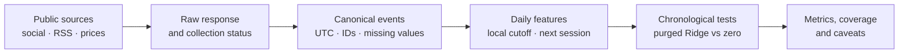
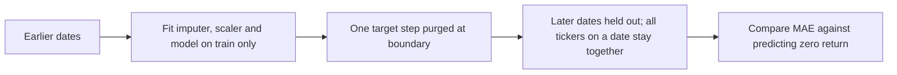

# HKEX + KRX sentiment-to-price research prototype

A beginner-friendly Python research project exploring whether public investor discussion adds information for **next-session returns** across five Hong Kong and five Korean stocks. The deliverable emphasizes reproducible data handling, time-aware validation, a simple baseline, and honest limits—not a claim of a winning strategy.

**Current state:** the tested prototype and real-data analysis run end-to-end on public/free-route substitutes. It is **not fully assignment-compliant yet**: no Apify Actor or Exa search was run under the strict $0 constraint. Do not confuse code adapters with provider usage.

> **Fast start:** read [the real run results](RUN_RESULTS.md), download [the interactive study pack](INTERVIEW_STUDY_PACK.html) and open it in a local browser (GitHub does not execute repository HTML), or skim the [interview cheat sheet](INTERVIEW_CHEATSHEET.md).

## What the real run found

The long price-only Ridge model was slightly worse than predicting a zero return in both markets. The tiny sentiment experiments had only three test dates per market and also lost to the no-change baseline. **No predictive edge or profitability is established.**

| Evaluation | Ridge MAE | Zero-return MAE | Test size |
|---|---:|---:|---:|
| HKEX price-only | 1.639% | **1.627%** | 1,940 predictions across 388 dates |
| KRX price-only | 2.707% | **2.695%** | 1,900 predictions across 380 dates |
| HKEX sentiment experiment | 4.563% | **1.927%** | 15 rows across 3 dates |
| KRX sentiment experiment | 4.502% | **2.581%** | 15 rows across 3 dates |

Lower mean absolute log-return error (MAE) is better. The long-history test validates price features only; it is not evidence of a long-history social-sentiment backtest.


*Social counts are bounded collected records, not the total activity on a site. A zero count means no records were retained—not proof that no discussion exists.*

## How the project works



The event timestamp is converted from UTC to the exchange timezone before cutoff alignment. The target is `log(close[t+1] / close[t])`, where `t+1` is the next supplied trading session—not the next calendar day.



This split reduces look-ahead leakage. A fixed Ridge model is used as a transparent baseline, and preprocessing is fit inside each training fold. Missing social telemetry is not converted into observed zero; retrospective cumulative engagement is excluded where historic as-of values are unavailable.

## Data snapshot and known gaps

| Data | Run count | Important caveat |
|---|---:|---|
| Social discussion | 1,499 rows | 1,475 Korea; only 24 Hong Kong; bounded samples |
| News | 110 headlines | RSS substitute; no Exa query |
| Daily bars | 4,875 rows | Third-party Yahoo data, not certified exchange closes |
| Latest quote snapshots | 10 | Not the same as a verified daily close; forecasts are provisional |
| Author followers | 0 observed | Missing for all 1,499 rows; do not treat as zero |

Korean records are heavily uneven by source and ticker. In Hong Kong, Moomoo provided 24 retained posts, LIHKG retained zero, and AIA has no retained social sample. Naïve Naver/Daum timestamps are interpreted as Seoul local; source-clock accuracy is not independently certified. The example cutoff/calendar choices still need authoritative exchange-calendar verification.

## Run it

Python 3.10+ is recommended. This repository is **code-only**: it intentionally excludes raw pages, post text, credentials, and row-level results. For the already-collected data and dashboard, use the separate full project package. To reproduce from a clean clone, run the free public collectors first; site behavior and availability can change.

```bash
git clone https://github.com/saishivasanjeethpaikarao-jpg/hengseng-sentiment-agent.git
cd hengseng-sentiment-agent
python -m venv .venv
# macOS/Linux
source .venv/bin/activate
# Windows PowerShell: .\.venv\Scripts\Activate.ps1
python -m pip install -e ".[dev,public]"
pytest -q
```

To recollect bounded public samples and then rebuild the offline report:

```bash
python scripts/collect_prices_public.py
python scripts/collect_quotes_public.py
python scripts/collect_news_public.py
python scripts/collect_kr_feeds.py
python scripts/collect_daum_public.py
python scripts/collect_hk_public.py
python scripts/run_real_pipeline.py
```

The HK public collector needs Playwright Chromium (install with `python -m playwright install chromium` if a supported system browser is unavailable). Collection uses no Apify/Exa key and no paid proxy. Read collector status outputs and the source limits before interpreting a sample as complete. `run_real_pipeline.py` itself is offline and makes no network calls. A full command reference and schemas are in [DATA_ACCESS.md](DATA_ACCESS.md) and [the learning guide](LEARNING_GUIDE.md).

## Repository map

| Path | Purpose |
|---|---|
| `config/assets.csv` | Example asset universe |
| `scripts/collect_*public.py` | Public, bounded collection scripts |
| `src/cwt_sentiment/features.py` | Timezone/session features and next-session targets |
| `src/cwt_sentiment/model.py` | Expanding chronological evaluation and forecasts |
| `scripts/run_real_pipeline.py` | Frozen offline evaluation and reports |
| `tests/` | Regression tests for time alignment, data quality and leakage guards |
| `INTERVIEW_STUDY_PACK.html` | Offline interactive study page with flowcharts, results charts, Q&A and quiz |
| `INTERVIEW_CHEATSHEET.md` | Quick interview-day revision sheet |

## Interview-ready explanation

> “I built a reproducible research prototype, but the simple Ridge model did not beat the zero-return baseline. I would not claim an edge: the sentiment test is too small, and Hong Kong social coverage is weak. I can explain the data alignment and leakage guards, and my next step is to satisfy the named provider requirements through a verified no-charge path, then collect better as-of coverage and rerun the same frozen test.”

See [RUN_RESULTS.md](RUN_RESULTS.md) for detailed metrics and caveats, [LEARNING_GUIDE.md](LEARNING_GUIDE.md) for the code walkthrough, [IMPLEMENTATION_PLAN.md](IMPLEMENTATION_PLAN.md) for a practical 5–7 day plan, and [DATA_ACCESS.md](DATA_ACCESS.md) for source-status details.

## Safety and scope

This is an academic research prototype, not investment advice. No claim of return, accuracy, or internship outcome is guaranteed. No credentials or individual social-post text are stored in this public repository. Keep `.env` private. The Apify and Exa adapters are not enabled by default; do not use them unless the service can be verified to remain within the $0 requirement.
